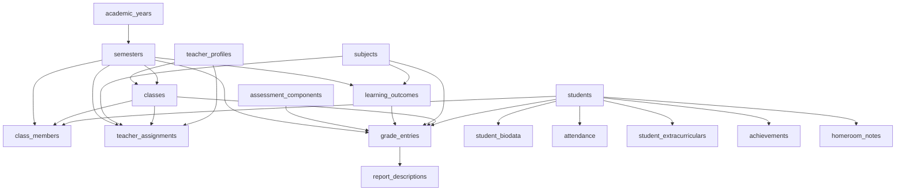

# Database RaporKu

**Status:** Dokumentasi struktur yang telah diterapkan  
**Terakhir diperbarui:** 11 September 2026  
**Sumber teknis:** `supabase/migrations/` dan `src/types/database.types.ts`

## 1. Ruang Lingkup

Dokumen ini menjelaskan database RaporKu yang benar-benar telah dibuat. Dokumen ini tidak menggantikan migration SQL. Jika ada perbedaan, migration terbaru menjadi acuan implementasi dan PRD tetap menjadi acuan produk.

Deployment MVP hanya melayani satu sekolah. Database tidak dirancang sebagai multi-tenant SaaS.

## 2. Platform

- Supabase PostgreSQL.
- Supabase Auth untuk akun pengguna.
- Supabase Row Level Security pada seluruh tabel aplikasi di schema `public`.
- Supabase Storage untuk foto siswa.
- UUID sebagai primary key utama.
- Nama tabel dan kolom memakai `snake_case`.
- Perubahan schema harus melalui file migration.

Frontend hanya menggunakan publishable key. Secret key dan service-role key tidak boleh digunakan di browser atau disimpan di repository.

## 3. Enum

| Enum                   | Nilai                                          | Kegunaan                                   |
| ---------------------- | ---------------------------------------------- | ------------------------------------------ |
| `user_role`            | `admin`, `homeroom_teacher`, `subject_teacher` | Role akun MVP                              |
| `class_template_group` | `lower_primary`, `upper_primary`               | Kelompok aturan/template kelas 1–3 dan 4–6 |
| `student_gender`       | `male`, `female`                               | Jenis kelamin siswa                        |

## 4. Kelompok Tabel

### 4.1 Akun dan Sekolah

| Tabel                    | Tujuan                                                                      |
| ------------------------ | --------------------------------------------------------------------------- |
| `profiles`               | Profil akun yang terhubung ke `auth.users`, role, dan status aktif          |
| `schools`                | Identitas lengkap satu sekolah, termasuk kepala sekolah                     |
| `public_school_identity` | Salinan publik terbatas untuk nama dan branding halaman login               |
| `teacher_profiles`       | Identitas guru, NIP/NUPTK, role, status, dan hubungan opsional ke akun Auth |

`public_school_identity` hanya membuka data branding yang diperlukan sebelum login. Data lengkap sekolah tetap dilindungi RLS.

### 4.2 Periode dan Struktur Kelas

| Tabel            | Tujuan                                                    |
| ---------------- | --------------------------------------------------------- |
| `academic_years` | Tahun ajaran dan penanda tahun aktif                      |
| `semesters`      | Semester 1/2 yang berada di dalam tahun ajaran            |
| `classes`        | Rombel kelas 1–6, wali kelas, periode, dan template group |
| `class_members`  | Riwayat penempatan siswa pada kelas dan semester          |

Constraint menjaga agar hanya ada satu tahun ajaran aktif dan satu semester aktif. Siswa hanya boleh memiliki satu kelas dalam semester yang sama.

### 4.3 Siswa dan Biodata

| Tabel             | Tujuan                                                                |
| ----------------- | --------------------------------------------------------------------- |
| `students`        | Identitas inti siswa, NIS/NISN, data lahir, agama, alamat, dan status |
| `student_biodata` | Nomor telepon, foto 3×4, serta biodata ayah, ibu, dan wali            |

Identitas inti dipisahkan dari biodata keluarga agar Wali Kelas dapat melengkapi data rapor tanpa memperoleh izin mengubah NIS, NISN, status siswa, atau penempatan kelas.

Data kesehatan, tinggi badan, dan berat badan tidak disimpan karena berada di luar MVP.

### 4.4 Mata Pelajaran dan Penugasan

| Tabel                                | Tujuan                                                                        |
| ------------------------------------ | ----------------------------------------------------------------------------- |
| `subjects`                           | Master mapel configurable, urutan, muatan lokal, status, dan kelompok agama   |
| `student_religion_subject_overrides` | Pengganti mapel agama per siswa dan semester tanpa mengubah biodata           |
| `teacher_assignments`                | Hubungan guru, kelas, mata pelajaran, tahun ajaran, dan semester              |
| `learning_outcomes`                  | CP generik per mata pelajaran, jenjang, dan semester                          |
| `assessment_components`              | Komponen penilaian configurable; awal MVP berisi Pengetahuan dan Keterampilan |

Guru Mata Pelajaran memperoleh scope akses dari `teacher_assignments`. CP tidak ditanamkan sebagai data statis pada frontend.

### 4.5 KKM dan Nilai

| Tabel               | Tujuan                                                                             |
| ------------------- | ---------------------------------------------------------------------------------- |
| `grading_settings`  | Menentukan mode KKM `single` atau `multi` per semester                             |
| `subject_kkm_rules` | KKM per mata pelajaran ketika mode `multi` aktif                                   |
| `grading_rules`     | Struktur KKM awal per kelas, mata pelajaran, dan semester yang masih dipertahankan |
| `grade_entries`     | Nilai 0–100 per siswa, CP, komponen, kelas, mapel, dan semester                    |

`grading_settings` dan `subject_kkm_rules` menjadi sumber konfigurasi KKM pada report view model saat ini. `grading_rules` masih memiliki service dan schema, sehingga tidak boleh dihapus tanpa audit penggunaan serta migration yang menjaga data lama.

Nilai akhir, rata-rata, dan predikat tidak disimpan sebagai angka manual terpisah. Nilai tersebut dihitung dari `grade_entries` menggunakan business logic aplikasi.

### 4.6 Isi dan Kelengkapan Rapor

| Tabel                             | Tujuan                                                                         |
| --------------------------------- | ------------------------------------------------------------------------------ |
| `report_descriptions`             | Draft sistem dan deskripsi final guru per siswa, mapel, komponen, dan semester |
| `attendance`                      | Jumlah sakit, izin, dan tanpa keterangan                                       |
| `extracurriculars`                | Master kegiatan ekstrakurikuler sekolah                                        |
| `student_extracurriculars`        | Hasil ekstrakurikuler siswa per kelas dan semester                             |
| `achievements`                    | Prestasi siswa                                                                 |
| `homeroom_notes`                  | Catatan atau saran Wali Kelas                                                  |
| `report_completion_confirmations` | Konfirmasi field opsional yang memang kosong untuk status kelengkapan          |

Leger dan dokumen rapor adalah derived output. Keduanya tidak disimpan sebagai tabel hasil manual.

## 5. Relasi Utama



Diagram menunjukkan alur utama, bukan seluruh foreign key dan indeks.

## 6. Aturan Integritas Penting

- Nilai hanya boleh berada pada rentang 0–100.
- KKM hanya boleh berada pada rentang 1–100.
- Mode `single` wajib memiliki satu KKM; mode `multi` memakai KKM per mapel.
- `grade_entries` mengikat siswa, kelas, mapel, CP, komponen, jenjang, dan semester yang konsisten.
- `report_descriptions` mengikat sumber CP terbaik/terlemah pada scope mapel, jenjang, dan semester yang sama.
- `subjects.religion_scope` bernilai `null` untuk semua siswa atau salah satu kelompok agama yang didukung; jika ada `student_religion_subject_overrides`, trigger memakai mapel pengganti itu, selainnya memakai `students.religion`.
- Setiap siswa hanya dapat memiliki satu mapel agama pengganti per semester, dan penggantian ditolak bila akan menyembunyikan nilai atau deskripsi mapel agama yang sudah tersimpan.
- NIS wajib dan unik.
- NISN opsional; jika diisi harus terdiri dari 10 angka dan unik.
- Tahun ajaran serta data historis tidak boleh dihapus hanya karena template berubah.
- Kolom `created_by`, `updated_by`, `created_at`, dan `updated_at` digunakan pada data yang memerlukan audit.
- Trigger `private.set_updated_at()` memperbarui waktu perubahan.

## 7. Function Database

| Function                                      | Fungsi                                                        |
| --------------------------------------------- | ------------------------------------------------------------- |
| `set_active_academic_year(uuid)`              | Mengganti tahun ajaran aktif secara atomik                    |
| `set_active_semester(uuid)`                   | Mengganti semester aktif dan menjaga konsistensi tahun ajaran |
| `import_students_to_class(uuid, uuid, jsonb)` | Mengimpor siswa dan penempatan kelas dalam satu operasi       |

Function publik harus memiliki grant eksplisit. Function import memakai `SECURITY INVOKER` agar tetap mengikuti izin pemanggil dan RLS.

Function internal serta trigger helper ditempatkan di schema `private` dan aksesnya dicabut dari `public`, `anon`, serta `authenticated` bila tidak diperlukan langsung.

## 8. Ringkasan RLS

### Anonymous

- Tidak boleh membaca data sekolah, guru, siswa, nilai, atau rapor.
- Hanya boleh membaca `public_school_identity` untuk nama/logo halaman login.

### Admin

- Mengelola identitas sekolah, periode, guru, kelas, siswa, mapel, penugasan, CP, konfigurasi KKM, dan data rapor sesuai policy.

### Wali Kelas

- Membaca siswa serta membaca dan menginput seluruh nilai kelas sendiri.
- Membuat dan mengedit deskripsi nilai kelas sendiri.
- Mengelola biodata keluarga/foto, absensi, ekstrakurikuler siswa, prestasi, catatan, serta konfirmasi kelengkapan hanya untuk kelas sendiri.

### Guru Mata Pelajaran

- Membaca kelas dan siswa yang ditugaskan.
- Mengelola CP, nilai, dan deskripsi hanya pada kelas/mapel/semester dalam assignment aktif.
- Tidak boleh mengubah nilai mapel guru lain.

Grant tabel hanya membuka jenis operasi/kolom yang diperlukan. RLS tetap menentukan baris yang boleh diakses.

## 9. Storage

Bucket privat:

| Bucket           | Isi                                | Batas                  |
| ---------------- | ---------------------------------- | ---------------------- |
| `student-photos` | Foto siswa untuk biodata dan rapor | JPG/PNG, maksimum 2 MB |

Path file memakai pola `<student_id>/photo`. Upload dengan upsert memerlukan policy SELECT, INSERT, dan UPDATE. Admin dapat mengelola foto siswa; Wali Kelas hanya dapat mengelola foto siswa dalam kelasnya. Aplikasi membaca foto melalui signed URL sementara.

## 10. Alur Data Rapor

```text
master + academic data + configuration
→ report service
→ report view model
→ template A4
→ preview / print / Save as PDF
```

Business logic tidak dijalankan di template cetak dan tidak disebarkan ke komponen UI.

## 11. Migration dan TypeScript

- Semua perubahan schema baru dibuat sebagai migration tambahan di `supabase/migrations/`.
- Jangan mengubah schema produksi secara manual tanpa migration tercatat.
- Setelah schema berubah, perbarui `src/types/database.types.ts`.
- Migration tidak boleh memasukkan password, token, atau data siswa nyata.
- Sebelum produksi, bandingkan daftar migration lokal dan remote serta jalankan pemeriksaan security/performance advisor.

## 12. Hal yang Masih Perlu Diaudit

- Konsolidasi `grading_rules` dengan `grading_settings`/`subject_kkm_rules` tanpa merusak data historis.
- Audit seluruh query Supabase dan kolom SELECT sebelum produksi.
- Verifikasi seluruh migration telah diterapkan pada project produksi.
- Verifikasi RLS menggunakan akun Admin, Wali Kelas, Guru Mata Pelajaran, dan anonymous.
- Strategi backup dan uji restore.
- Versioning template rapor historis jika format pemerintah berubah.

Dokumen ini mencatat kondisi saat ini; poin audit bukan izin untuk mengubah schema tanpa tahap dan persetujuan yang sesuai.
